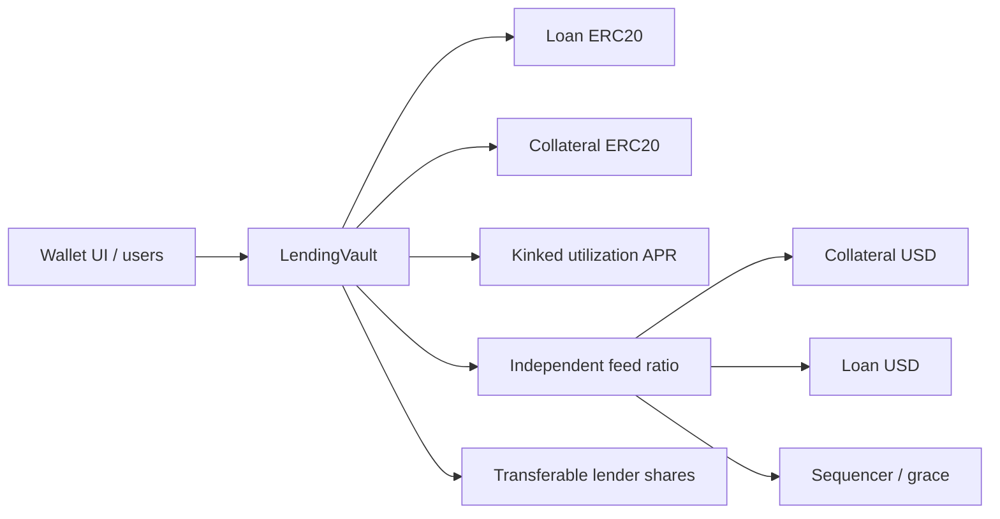
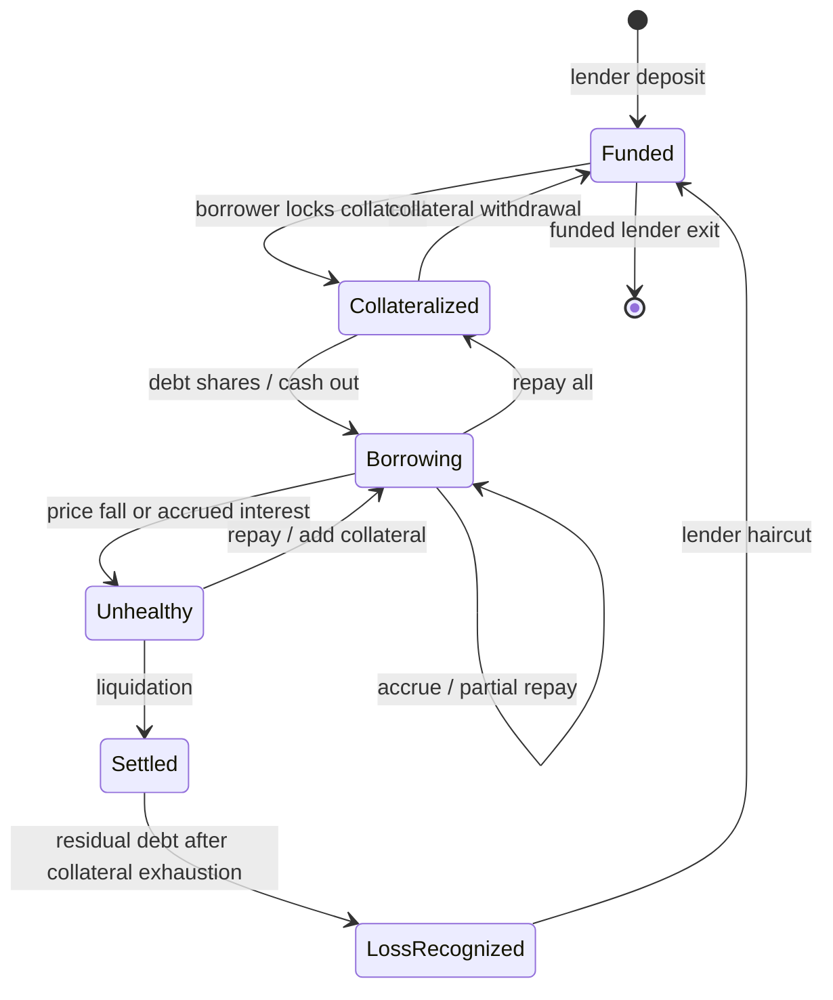
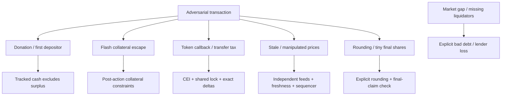

# Isolated Lending Vault
A collateralized credit protocol that makes lender ownership, indexed debt and insolvency settlement explicit.

This is the **lending series of B2 DeFi**, separate from the AMM. It demonstrates how money moves through a state machine and how those transitions are attacked and tested. **AI-Assisted Self-Assessment**, not an independent audit or a real-funds product.

[](https://github.com/chenhynju/b2-lending/actions/workflows/verify.yml) [](https://github.com/chenhynju/b2-lending/actions/workflows/pages.yml)

**Release acceptance: PARTIAL.** Local implementation, economic/security self-assessment, coverage, receipt-verified UI and reproducibility checks pass. A [public Base Sepolia demo market](docs/deployment/base-sepolia-live.md) is deployed, **source-verified 4/4**, and functionally verified (synthetic assets and quote, not the production Chainlink path). Production-network deployment, independent third-party audit and owner mastery remain NOT RUN/BLOCKED.

## Reviewer quick start
- **Live demo:** https://b2-lending-app.vercel.app (Base Sepolia; synthetic test assets only) · [GitHub Pages mirror](https://chenhynju.github.io/b2-lending/)
- **Deployment evidence:** [Base Sepolia live report](docs/deployment/base-sepolia-live.md) · [machine record](deployments/base-sepolia-live.json)
- **Contracts:** [vault](https://base-sepolia.blockscout.com/address/0x4A9c4C103EC26ED88528A9c8DAf032BEdB854999) · [mUSD](https://base-sepolia.blockscout.com/address/0x450C689f0702Be8AF310A50D7fd6E009Abecb5D7) · [mETH](https://base-sepolia.blockscout.com/address/0xcAf05CF9D12A05B928E6cE473f680A7fd0023DE6) · [quote](https://base-sepolia.blockscout.com/address/0xb27100D4d478A439D31E48d89aA348D33303d7Ab)
- **Try it:** switch MetaMask to Base Sepolia, claim `mUSD` and `mETH` from the two token contracts (Write Contract → `claim`), then connect the UI and supply, collateralize and borrow.

## Quick start
Use WSL Ubuntu 24.04 and Foundry **1.8.1**. Solidity **0.8.38** is pinned; dependencies are vendored, so no forge install is required.
```sh
forge --version
python3 scripts/dependencies.py
forge test
python3 scripts/reference_model.py
forge test --match-contract LendingInvariant -vv
```
The repository root is the Foundry root. Public repository: https://github.com/chenhynju/b2-lending. A companion Git bundle provides an offline clone/review path; the repository is self-contained apart from the pinned toolchain. First-time compiler installation needs internet or the checksum-verified compiler described in [toolchain records](evidence/toolchain/compiler.json).

Optional validation:
```sh
python3 scripts/campaign.py                   # actual >=30-minute changing-seed campaign
MAINNET_RPC_URL=https://your-archive-rpc forge test --match-contract MainnetForkTest -vvvv
python3 scripts/isolated_checks.py coverage
python3 scripts/isolated_checks.py static
python3 scripts/static_gate.py
forge snapshot --match-contract LendingVaultTest --fuzz-seed 0x20261105 --check
```
The fork test explicitly skips when MAINNET_RPC_URL is absent. A successful ordinary forge test does not mean a real-state fork ran. [Recorded fork](evidence/mainnet-fork.json) uses real USDT/WETH/feed state and synthetic fixture balances.

## Business problem
Lenders need transferable claims on cash and receivables. Borrowers need auditable collateral and debt. During volatility a protocol must distinguish unavailable liquidity, unhealthy debt and realized insolvency. Hiding bad debt as a collectible asset overstates lender equity.

## Architecture


[Architecture/HLD](docs/architecture/overview.md) · [LLD](docs/design/low-level.md) · [source](src/LendingVault.sol) · [ADRs](docs/adr/decisions.md)

## Protocol mechanics
- Exact-transfer loan/collateral assets; decimal normalization supports 0–18 token decimals.
- Lender shares round down on mint/redeem; exact-asset withdrawals burn shares up.
- Debt shares use a RAY-scaled borrowIndex and conservative liability rounding.
- Utilization APR: 2% base, 10% at 80% utilization, 100% at full utilization.
- Origination LTV 75%, liquidation threshold 80%, liquidation bonus 5%.
- Permissionless repayment and liquidation, no owner/upgrader/admin withdrawal.
- Direct donations are excluded from claim pricing. Transfer-tax and rebasing tokens are unsupported.
- Collateral exhaustion immediately writes off residual debt and reduces lender share value.



Shares are **ownership units**, not raw assets. The correct identities are sum(balances)=totalSupply and totalAssets=cash+aggregateDebt. Subsequent price shocks can make a previously valid loan unhealthy. “Liquidation settled” does not mean “no lender loss.”

## Security model and attack surface


No system can promise zero bad debt under arbitrary price gaps. [Economic model](docs/economics/economic-model.md), [invariants](docs/economics/invariants.md), [attack scenarios](docs/economics/attack-scenarios.md) and [assessment](docs/economics/economic-security-assessment.md) state bounds and assumptions.

## Testing and evidence
[Unit/fuzz](test/LendingVault.t.sol) · [oracle tests](test/FeedOracle.t.sol) · [handler](test/invariant/LendingHandler.sol) · [nine invariant properties](test/Invariant.t.sol) · [economic attacks](test/EconomicAttack.t.sol) · [integer differential](test/Differential.t.sol) · [mainnet fork](test/fork/MainnetFork.t.sol).

The handler maintains ghost cash/share/collateral ledgers for four actors and varies time, price, borrow, repay, supply, withdrawal and liquidation. Unexpected vault reverts are not swallowed. Conditional closeout funds repayment and checks complete lender exit. This does not prove unconditional withdrawal liquidity.

[Fresh offline clone](evidence/fresh-clone.json) validates dependency bytes, tests and the fixed-seed gas gate from a clean checkout.

[Results and gates](docs/testing/results.md) · [timed campaign](evidence/campaign.json) · [coverage](evidence/coverage.json) · [mutation tests](evidence/mutation.json) · [gas/optimizer comparison](evidence/optimizer-matrix.json) · [reproducible builds](evidence/reproducible.json).

## Audit findings and remediation
One confirmed Low issue, [final-share orphaned receivables](docs/audit/findings/L-01-last-share.md), has a real vulnerable commit, execution trace, fix and regression. Four targeted mutants are killed. Slither/Aderyn raw findings are retained and [triaged](docs/audit/static-triage.md).
[Assessment](docs/audit/final-report/report.md) · [frozen scope](docs/audit/scope.md) · [compiler review](docs/audit/compiler-review.md) · [dependency review](docs/audit/dependency-review.md).

## Local UI and deployment
The static EIP-1193 wallet UI uses BigInt, compiled selectors, explicit action review, configured chain checks and bounded approvals. No signing key is embedded. It handles supply/withdraw/redeem, collateral, borrowing/repayment and liquidation. Live builds copy `apps/web/config.live.json` to `config.json`; Vercel serves the primary demo and GitHub Pages serves the mirror.
```sh
npm ci
npx playwright install --with-deps chromium
python3 scripts/local_smoke.py --serve
# Local wallet RPC: http://127.0.0.1:18545, chain 31337
# Page: http://127.0.0.1:18080
```
The [receipt-verified browser run](evidence/browser.json) covers all vault actions, invalid input, healthy liquidation rejection, wrong network and account/chain changes. [Desktop](evidence/frontend-desktop.png) and [mobile](evidence/frontend-mobile.png) captures are from that run.

[Deployment/preflight](docs/deployment/README.md) · [production script](script/Deploy.s.sol).
Base Sepolia demo (chain 84532) is live: [deployment report](docs/deployment/base-sepolia-live.md) · [machine record](deployments/base-sepolia-live.json). Deployer `0x0118e172324801a6333e7d0fAF7f9BB4ED72628F`; vault [`0x4A9c4C103EC26ED88528A9c8DAf032BEdB854999`](https://base-sepolia.blockscout.com/address/0x4A9c4C103EC26ED88528A9c8DAf032BEdB854999). The demo uses free-claim synthetic tokens and an operator quote, not production feeds. Base Sepolia signing/broadcast was explicitly authorized; mainnet requires separate authorization.

## Performance and trade-offs
Optimized IR variants at 200/1,000/10,000 runs are measured. The 1,000-run vault runtime is **10,984 bytes**, creation bytecode **12,542 bytes** before constructor arguments. Non-IR variants fail stack-depth compilation and are reported, not dropped. [Gas comparison and receipt measurements](docs/testing/performance.md) include deployment/function gas. [ADRs](docs/adr/decisions.md) explain the chosen middle-size/execution-cost trade-off.
Storage ReentrancyGuard is supplied by OZ 5.0.2; transient guard is unavailable in that pinned release, so no invented comparison is presented.

## Known limitations
- Coverage is 36/38 vault branches (94.74%), 8/8 oracle and 2/2 rate-model branches. Two vault constructor branches remain uncredited; negative constructor cases execute. This is not a claim of complete formal coverage.
- Historical failed and invalidated browser runs remain in evidence; summary.json identifies the current passing receipt-verified run.
- Unsupported token behaviors, blacklist/pause/upgrades and feed governance remain trust boundaries.
- No liquidation backstop, insurance, emergency administrator or guaranteed withdrawal liquidity.
- Nominal APR compounds with checkpoint frequency; finite index cap eventually stops interest and creates coarse debt granularity.
- Donations are stranded surpluses; no admin rescue exists.
- A public RPC can prune the pinned fork block; use archive access.
- Remote CI is green and Blockscout source verification is 4/4; independent third-party audit is not completed. The Base Sepolia demo deployment is complete; the production Chainlink market and mainnet deployment are NOT RUN.
- The live demo quote is operator-controlled by the deployer address and currently reads `2000e18`; a live liquidation would require that wallet to sign `setQuote`. Liquidation and bad-debt socialization are exercised in local/fork tests, not on the public demo.
- Frontend is intentionally a small static demo, not the default Next.js stack.
- Learning materials are provided; owner mastery is NOT RUN.

## Walkthrough and interview defense
[Source walkthrough](docs/code-walkthrough/README.md) · [math derivation](docs/economics/economic-model.md) · [Chinese exercises / reference answers](docs/learning/interview-defense.md).

## Engineering contributions
Custom: lending/accounting state machine, indexed debt integration, liquidation/loss settlement, feed adapter policy, handler/ghost tests, reference model, adversarial fixtures, evidence tooling and wallet demo. Third-party: OZ ERC20/SafeERC20/Math/ReentrancyGuard, Foundry execution, Chainlink feeds and Playwright. This implementation/documentation is AI-assisted; authorship of generated material is not proof of the portfolio owner's independent skill.

Future work must first close verification gaps, obtain independent review and validate market-specific risk/operations. It is not appropriate to expand features while treating unaccepted gates as complete.

Development follows the [WSL commit, push, Windows pull workflow](docs/deployment/workspace-workflow.md). Wallet-context security regressions run in CI with node scripts/wallet_context_test.cjs.
