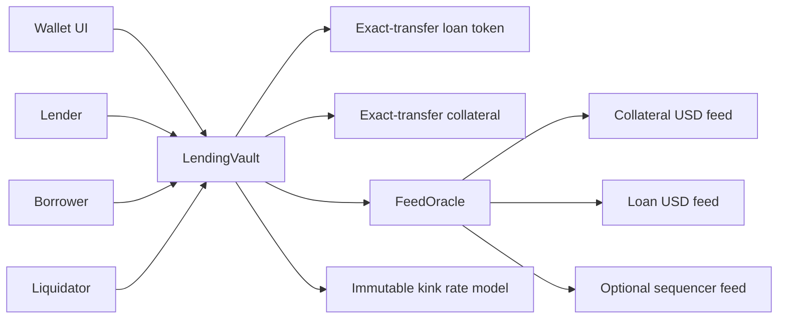

# Architecture / HLD
A market holds two different ERC20s: loan asset and collateral. Lenders own iLEND ERC20 claims on tracked cash plus indexed receivables. Borrowers own collateral balances and debt-share liabilities. The market has no owner, upgrade proxy, fee collector, rescue role or mutable risk parameters.

## Boundaries
- A market deployer selects tokens, correct feeds, heartbeat and chain. Wrong feed selection is not discoverable by arithmetic alone.
- Both tokens must be non-rebasing, exact-transfer assets. Token upgrade administrators, blocklists, pauses and oracle governance remain external trust.
- USD ratio prices account for loan-token depegs. No spot-price or AMM-reserve fallback exists.
- Ethereum may omit sequencer validation. Base mainnet constructor rejects omission; the production deployment script also rejects omission on other non-Ethereum chains.
- The browser supports local chain 31337 and Base Sepolia 84532 only. It contains no signing key.
- Local demos use unrestricted test tokens and mutable MockOracle. They must never be represented as a production price feed.

## Asset flows
Deposit pulls loan tokens and mints lender shares. Borrow creates debt shares and transfers cash. Repay burns debt shares and returns cash. Liquidation exchanges liquidator cash for borrower collateral and removes any uncovered residual receivable. Only the remaining real receivable is reflected in lender share value.

[LLD](../design/low-level.md) · [economics](../economics/economic-model.md) · [security](../audit/final-report/report.md)
