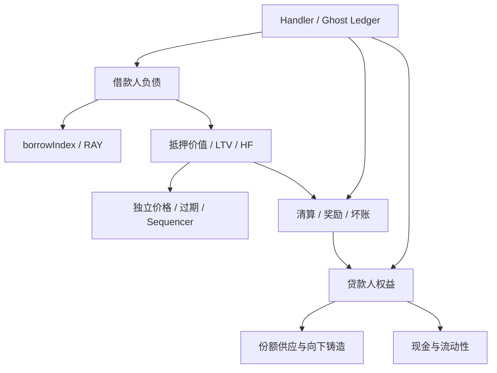

# 学习与面试答辩
学习验收：**NOT RUN**。材料和 AI 代写不能证明你已经掌握；需要你实际讲解与完成练习。

## 知识图谱


## 业务原理与执行轨迹
贷款人存 10,000 单位借款资产，借款人锁 1 ETH（测试价格 2,000），借 1,000。现金变 9,000，债权变 1,000，总权益仍约 10,000。利用率约 10%，名义 APR 约 3%。利息增加债权，不会凭空增加现金。还款以后现金才能支付利息收益。价格跳到 500 时，最多约 476.19 的偿还购买全部抵押品，剩余约 523.81 形成贷款人损失；实际整数结果见 local-smoke.json，而不是把小数示例当测量。

逐步运行：
```sh
forge test --match-test testInterestAndFullRepayment -vvvv
forge test --match-test testGapLossSocialization -vvvv
forge test --match-contract LendingInvariant -vv
```
从 trace 指出 deposit 的 mint、借款的债务份额、accrue 的指数、repay 的 burn 和清算的 BadDebt 事件。说明每次 ERC20 外部调用之前哪些状态已经改变。

## 必须独立回答
1. 为什么 shares 的原始整数不能直接等于 totalAssets？答：单位不同且价格可变；应校验供应守恒和资产会计恒等式。
2. 借款为何向上取债务份额，还款也向上收款？答：不能让新增/退出的借款人把舍入成本转给现有贷款人；两次向上可能产生微小盈余。
3. 为什么 sum(debtOf) 可能比 totalDebt 多？答：每个账户 ceil 与总和后 ceil 不交换，N 人差额至多 N−1 个原始单位。
4. 哪个 handler 性质最容易被谁打破？答：现金 ghost ledger 易被非标准转账/漏记路径打破；资产恒等式易被坏账不冲销打破；债务供应易被清算漏烧份额打破。指出具体 action 与 ghost 写入。
5. 为什么 invariant 不是“先存再取一次”？答：handler 在多个参与者、时间、价格和动作组合中保留状态，所有性质随序列持续检查，afterInvariant 再完成有条件退出。
6. 闪电贷能否制造健康抵押？答：若价格是安全的独立 feed，闪电贷不能改变估值；借后取回全部抵押会失败。若使用可操纵 spot oracle，则答案不同。
7. 为什么还款和补抵押不依赖价格？答：它们降低风险，不应被陈旧 feed 阻断。
8. 为什么清算不能保证没有损失？答：跳空、拥堵和流动性不足可以让抵押价值低于负债；会计必须确认损失。
9. 只读重入能读到什么？答：代币回调期间 guarded valuation 会 revert；原始 public getter 仍可读，集成不能自行用部分状态重建价格。
10. APR 等于 APY 吗？答：不等，checkpoint 频率产生复利，满利用率频繁结算的年收益趋近 exp(1)−1。
11. 最后一个份额为什么需要特殊校验？答：向上烧份额可能把最后一份烧完，但现金提取小于全部权益。用 L-01 轨迹说明。
12. 主网 fork 哪些是真、哪些是合成？答：区块、代币代码、feed 状态真实；deal 注入的测试余额是合成；没有真实链上广播。

## 实作练习（完成后才能验收）
- 不看实现，用 Python 推导 6/18 decimals 的 collateral value，给出每个量的单位。
- 把 repay 改成 Floor，在隔离 worktree 运行测试，解释最小失败输入；修复后再跑。
- 给 handler 增加第五个参与者，修改舍入误差上界并验证。
- 设计 oracle 过期但用户要降低债务的故障流程，指出应开放/关闭的 API。
- 证明部分清算不会在支持的整数范围内多拿 collateral；说明 dust 和 index 上限例外。
- 对一次真实本地清算，分开计算新增利息、偿还舍入盈余和坏账，验证资产恒等式。

## 调试和部署答辩
forge --debug 单步查找第一次不满足假设的状态；先固定 seed，再最小化 sequence，不删除失败测试。解释 Foundry constructor args、creation/runtime bytecode、immutable references、chainId、签名、广播、receipt status 与 explorer source verification 的区别。请求被接收不等于上链成功。公共交易和主网发布各自需要明确授权。
